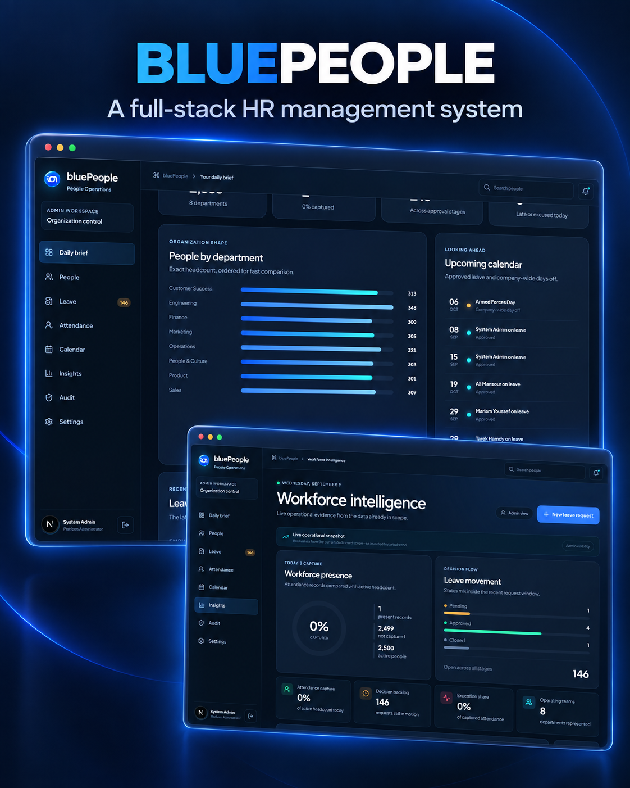
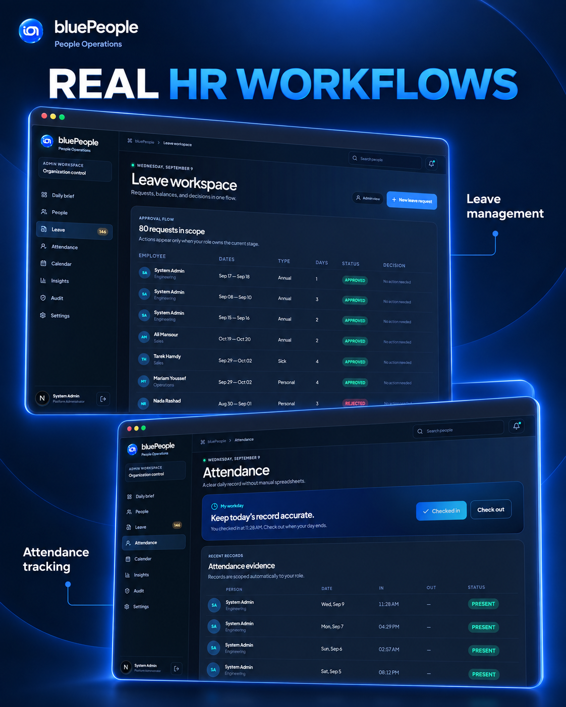
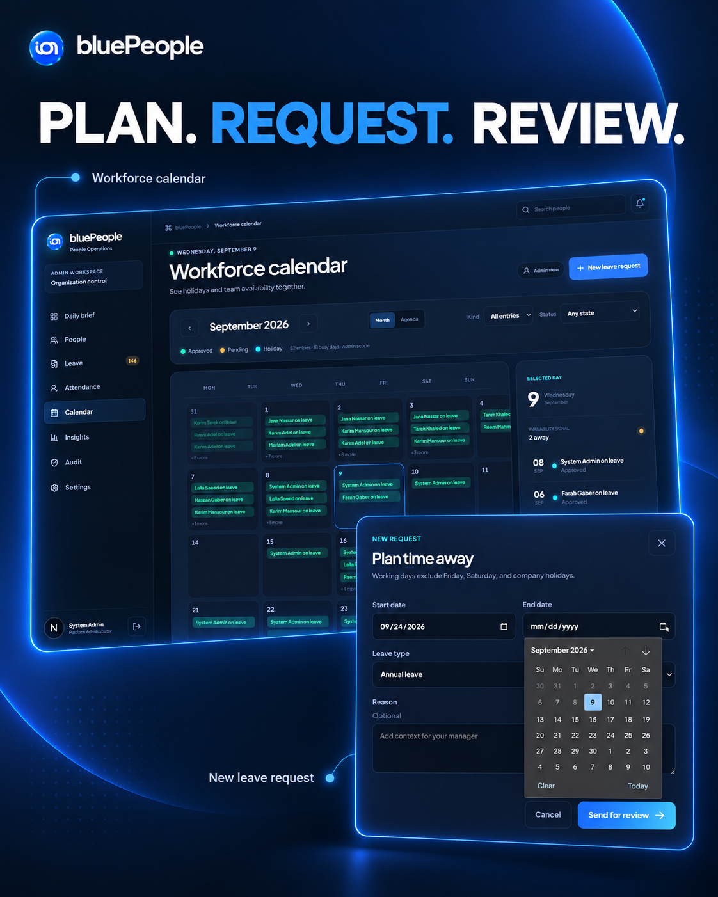
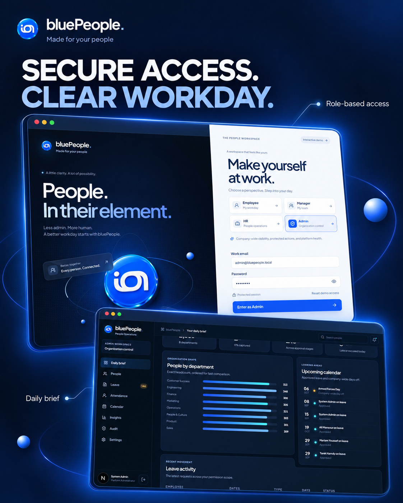

# HR Management System

A full-stack HR application developed around employee records, departments, leave requests, attendance, and reporting.

## Architecture

The Go API uses a handler → service → repository structure with PostgreSQL and versioned migrations. A TypeScript frontend provides administrator and employee workflows.

## Features

- Token-based authentication and role-based access.
- Employee and department management.
- Leave requests, approval workflows, and attendance tracking.
- Filterable lists, reporting, and an OpenAPI contract.

## Product gallery

### Leave and attendance

### Workforce calendar

### Access and daily brief

## Run locally

The project contains a Docker Compose configuration and an example environment file. Review the configuration, set your own credentials and secrets, and run `docker compose up --build`. The API and frontend include their own dependencies and test suites.

Development settings are examples and should be replaced before any deployment. No employee database or production credentials are included.
